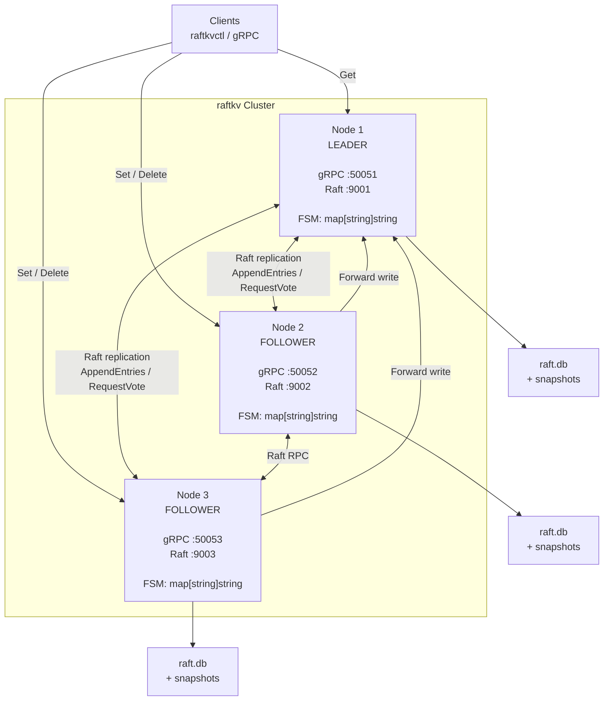
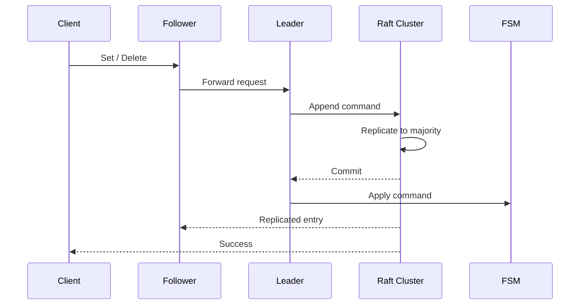
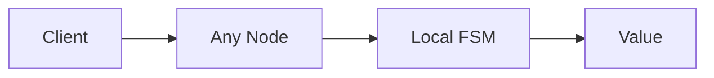
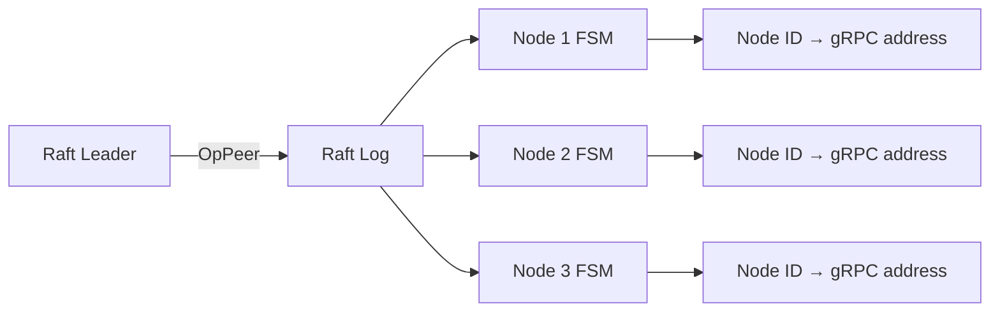
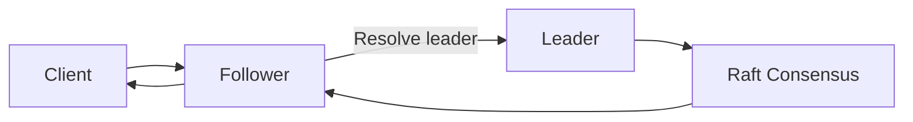
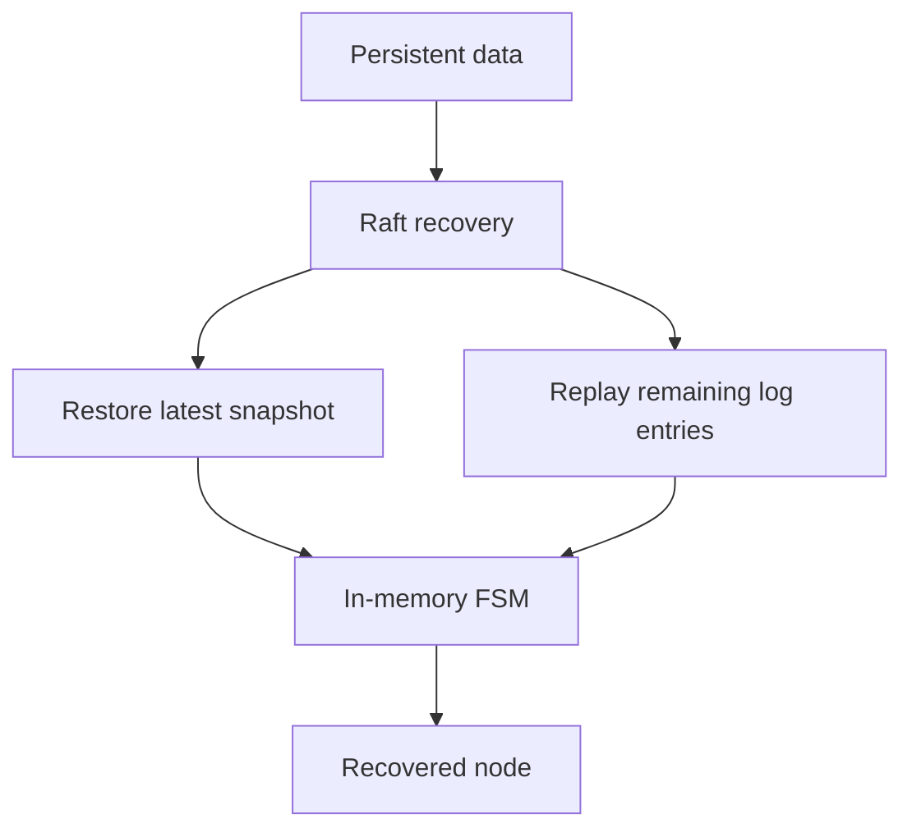

# raftkv

A replicated key-value store built in Go using [HashiCorp Raft](https://github.com/hashicorp/raft), with a gRPC client API.

`raftkv` runs a three-node cluster with a single Raft group and an in-memory key-value state machine. State is persisted through Raft's durable log and snapshots, with **no external database**.

Writes go through the Raft consensus path and are **linearizable**. Reads are served locally by the contacted node and are therefore **potentially stale**. This trade-off is intentional and documented below.

---

## Features

* Raft-based replication using HashiCorp Raft
* Linearizable `Set` and `Delete` operations
* Local, low-latency `Get` operations
* Automatic follower-to-leader write forwarding
* Automatic leader election and failover
* Persistent Raft log and stable state using BoltDB
* Raft snapshots for FSM persistence and log compaction
* gRPC API
* CLI client for cluster operations
* Three-node cluster deployment with Docker Compose
* No external database or coordination service
* Cluster membership and leader discovery
* Failover and throughput demonstration scripts

---

## Architecture



### Write path



A write is acknowledged only after the Raft cluster has committed the entry through a majority.

### Read path



Reads do not contact the leader and do not require a Raft round trip.

---

## Leader Discovery

Raft peers communicate using their **Raft addresses**, while clients and write forwarding use **gRPC addresses**.

`raftkv` keeps the mapping between node IDs and gRPC addresses inside the replicated state machine.

When a node becomes leader or admits a new node, the mapping is replicated through the Raft log using an `OpPeer` entry.



This allows a follower to resolve the current leader's gRPC address without relying on an external service registry.

The mapping is also restored from snapshots after restart.

---

## Consistency Model

`raftkv` intentionally provides different consistency guarantees for reads and writes.

### Writes

**Writes are linearizable.**

A `Set` or `Delete` operation:

1. Is accepted by the current leader.
2. Is appended to the Raft log.
3. Is replicated to a majority of nodes.
4. Is committed.
5. Is applied to the FSM on each node in log order.
6. Returns success to the client.

For a three-node cluster:

```text
Cluster size = 3
Quorum       = 2
```

A successfully committed write survives the loss of any one node.

If leadership is lost while a write is being processed, the request fails rather than being reported as successfully committed.

### Reads

**Reads are local and potentially stale.**

`Get` reads directly from the contacted node's FSM.

This provides:

* No leader round trip
* No consensus operation
* No disk operation
* Low read latency
* Read throughput distributed across nodes

The trade-off is that:

* A follower may temporarily return older data.
* There is no explicit staleness bound.
* There is no cross-node read-your-writes guarantee.

For applications requiring linearizable reads, reads would need to be routed through the leader or implemented using a stronger Raft read-consistency mechanism such as `raft.Barrier()` / ReadIndex.

---

## Write Forwarding

Clients may send writes to any node.

If the contacted node is a follower, it resolves the current leader and forwards the request.



Forwarded requests contain:

```text
raftkv-forwarded: 1
```

If a forwarded request reaches another follower, the marker prevents an infinite forwarding loop. The request fails with an error containing the known leader address.

Example:

```text
not leader, leader is at <address>
```

Successful write responses identify the leader that processed the request.

---

## Repository Structure

```text
raftkv/
├── cmd/
│   ├── raftkv/              # Node entrypoint and flag parsing
│   └── raftkvctl/           # Client CLI
│
├── internal/
│   ├── api/                 # Protobuf definitions and gRPC server
│   ├── cluster/             # Cluster join and retry/backoff logic
│   ├── fsm/                 # Raft FSM, snapshots and restoration
│   └── store/               # Raft node, membership and write path
│
├── scripts/
│   ├── bench.sh             # Throughput benchmark
│   └── killnode.sh          # Failover demonstration
│
├── docker-compose.yml
├── go.mod
└── README.md
```

---

## Getting Started

### Requirements

* Go **1.26+**
* Docker and Docker Compose *(optional)*
* Buf or `protoc` *(only required when regenerating gRPC code)*

---

## Run with Docker

Build and start the cluster:

```sh
docker compose up -d --build
```

Check the cluster:

```sh
docker compose ps
```

Check node status:

```sh
docker compose exec node1 \
  raftkvctl -addr 127.0.0.1:50051 status
```

`node1` bootstraps the cluster. `node2` and `node3` wait for `node1` to become healthy and then join through the `Join` RPC.

Each node uses its own Docker volume, so Raft state survives container restarts.

```sh
docker compose restart
```

### Host ports

| Node    | gRPC    | Raft   |
| ------- | ------- | ------ |
| `node1` | `50051` | `9001` |
| `node2` | `50052` | `9002` |
| `node3` | `50053` | `9003` |

Example write through a follower:

```sh
go run ./cmd/raftkvctl \
  -addr 127.0.0.1:50052 \
  set greeting hello
```

Read from another node:

```sh
go run ./cmd/raftkvctl \
  -addr 127.0.0.1:50053 \
  get greeting
```

Expected output:

```text
hello
```

---

## Run Without Docker

Build the binaries:

```sh
go build -o bin/ ./cmd/...
```

### Node 1 — Bootstrap

```sh
bin/raftkv \
  -id=node1 \
  -bootstrap \
  -raft-addr=127.0.0.1:9001 \
  -grpc-addr=127.0.0.1:50051 \
  -data-dir=tmp/n1
```

### Node 2

```sh
bin/raftkv \
  -id=node2 \
  -join=127.0.0.1:50051 \
  -raft-addr=127.0.0.1:9002 \
  -grpc-addr=127.0.0.1:50052 \
  -data-dir=tmp/n2
```

### Node 3

```sh
bin/raftkv \
  -id=node3 \
  -join=127.0.0.1:50051 \
  -raft-addr=127.0.0.1:9003 \
  -grpc-addr=127.0.0.1:50053 \
  -data-dir=tmp/n3
```

Test the cluster:

```sh
bin/raftkvctl \
  -addr 127.0.0.1:50052 \
  set alpha one

bin/raftkvctl \
  -addr 127.0.0.1:50053 \
  get alpha
```

Expected:

```text
one
```

---

## Configuration

| Flag              | Default           | Description                                      |
| ----------------- | ----------------- | ------------------------------------------------ |
| `-id`             | `node1`           | Unique and stable node identifier                |
| `-raft-addr`      | `127.0.0.1:9001`  | Raft bind address                                |
| `-raft-advertise` | `-raft-addr`      | Address advertised to Raft peers                 |
| `-grpc-addr`      | `127.0.0.1:50051` | gRPC bind address                                |
| `-grpc-advertise` | `-grpc-addr`      | gRPC address used for forwarding                 |
| `-join`           | —                 | Comma-separated gRPC addresses of existing nodes |
| `-bootstrap`      | `false`           | Bootstrap a new single-node cluster              |
| `-data-dir`       | `data`            | Persistent Raft data and snapshots               |
| `-log-level`      | `info`            | Application log level                            |
| `-raft-log-level` | `warn`            | Raft internal log level                          |

`-bootstrap` and `-join` are mutually exclusive.

A node with existing state in `-data-dir` neither bootstraps nor re-joins. It restores its existing Raft state and reconnects to the cluster it already belongs to.

---

## Failover

The repository includes a failover demonstration:

```sh
scripts/killnode.sh
```

Or stop a specific node:

```sh
scripts/killnode.sh node2
```

The script:

1. Finds the current leader.
2. Writes a test key.
3. Stops the selected node.
4. Waits for the surviving nodes to elect a leader.
5. Verifies the pre-failure key.
6. Performs fresh writes through the surviving cluster.
7. Exits with a non-zero status if recovery fails.

### Leader election

After a leader failure, there is a short election window during which writes may return:

```text
UNAVAILABLE
```

This is expected.

The current configuration uses:

```text
Heartbeat timeout: 500ms
Election timeout:  500ms
```

The exact election time depends on scheduling and runtime conditions.

Restart a stopped node with:

```sh
docker compose start node1
```

Then inspect its state:

```sh
docker compose exec node1 \
  raftkvctl -addr 127.0.0.1:50051 status
```

The recovered node catches up from the replicated Raft log.

---

## Snapshots

The Raft FSM implements:

* `Snapshot`
* `Restore`

Snapshots contain:

* Key-value state
* Replicated peer metadata

Raft periodically creates snapshots after the configured log threshold.

To trigger a snapshot manually:

```sh
docker compose exec node1 \
  raftkvctl -addr 127.0.0.1:50051 snapshot
```

Snapshots allow older Raft log entries to be compacted while preserving the current FSM state.

---

## Persistence

Each node stores persistent Raft state under its configured data directory:

```text
<data-dir>/
├── raft.db
└── snapshots/
```

The persistent state contains the Raft log and stable Raft state.

Snapshots contain the serialized FSM state.

The key-value map remains in memory during normal operation.



---

## API

The gRPC API is defined in:

```text
internal/api/kv.proto
```

The API provides operations for:

* `Get`
* `Set`
* `Delete`
* Cluster status
* Leader discovery
* Snapshot operations
* Cluster joining

Generated gRPC bindings are used by both the server and `raftkvctl`.

---

## CLI

`raftkvctl` provides a command-line interface for interacting with the cluster.

Available operations include:

```text
get
set
del
status
leader
snapshot
bench
```

Example:

```sh
raftkvctl \
  -addr 127.0.0.1:50051 \
  set key value
```

```sh
raftkvctl \
  -addr 127.0.0.1:50051 \
  get key
```

---

## Benchmarking

Run the default benchmark:

```sh
scripts/bench.sh
```

Default configuration:

```text
Operations: 2,000
Workers:    16
```

Custom configuration:

```sh
scripts/bench.sh 10000 32
```

The benchmark measures:

1. Writes directly against the leader
2. Writes against a follower
3. Local reads

Follower writes include an additional forwarding hop.

Local reads avoid the Raft consensus path entirely.

> Benchmark results depend heavily on hardware, Docker configuration, network conditions, and workload characteristics. They should not be interpreted as production performance numbers.

---

## Failure Model

For a three-node cluster:

| Failure            | Writes                                                 | Reads                                      |
| ------------------ | ------------------------------------------------------ | ------------------------------------------ |
| One follower fails | Continue                                               | Continue on remaining nodes                |
| Leader fails       | Temporarily unavailable during election, then continue | Surviving nodes can serve local reads      |
| Two nodes fail     | Stop until quorum returns                              | Remaining node may serve stale local state |
| Network partition  | Majority partition can commit writes                   | Reads remain local and may be stale        |

A three-node cluster requires:

```text
Quorum = 2
```

Therefore, losing two nodes prevents further committed writes until quorum is restored.

---

## Design Trade-offs

`raftkv` intentionally favors a small, understandable distributed-systems architecture.

| Design decision      | Benefit                                    | Trade-off                       |
| -------------------- | ------------------------------------------ | ------------------------------- |
| Raft consensus       | Linearizable writes and automatic failover | Consensus latency               |
| Local reads          | Low latency and distributed read load      | Potentially stale data          |
| Follower forwarding  | Clients can contact any node               | Additional network hop          |
| In-memory FSM        | Fast state access                          | Dataset limited by memory       |
| Raft snapshots       | Durable recovery and log compaction        | Snapshot serialization overhead |
| Single Raft group    | Simple cluster architecture                | No horizontal write scaling     |
| No external database | Self-contained deployment                  | Limited storage model           |

---

## Known Limitations

### Consistency

* Reads may be stale.
* There is no staleness bound.
* There is no cross-node read-your-writes guarantee.
* Linearizable reads are not currently implemented.

### Client routing

* Clients do not maintain a persistent leader cache.
* Writes sent to followers require an additional forwarding hop.
* Clients must retry operations that fail during leader elections.

### Failover

* Writes during an election window can return `UNAVAILABLE`.
* The server does not automatically retry failed client operations.
* Membership changes are manual.

### Data model

Currently supported:

* Single-key `Set`
* Single-key `Delete`
* Single-key `Get`

Not currently supported:

* Transactions
* Compare-and-swap
* Atomic multi-key operations
* Watches
* TTLs
* Range scans
* Key iteration

### State size

The complete FSM state is held in memory.

Snapshots currently serialize the state as a single JSON representation. This is suitable for small datasets and demonstrations; larger state would require a streaming or chunked snapshot format.

### Security

The current implementation does not provide:

* TLS
* Authentication
* Authorization
* Network-level access control

The gRPC API is plaintext, and cluster membership operations are not authenticated.

**Do not expose `raftkv` to an untrusted network.**

### Membership

* Membership changes are manual.
* There is no `Leave` RPC.
* Permanently failed nodes remain voters until explicitly removed.
* Losing two of three nodes stops committed writes until quorum is restored.

### Scaling

`raftkv` uses a single Raft group.

All writes therefore pass through one leader, and write throughput is bounded by that leader's processing, disk, and network capacity.

Horizontal scaling would require partitioning the keyspace across multiple Raft groups.

---

## Development

Run the build and static checks:

```sh
go build ./...
go vet ./...
```

### Regenerate gRPC code

Install the protobuf plugins:

```sh
go install google.golang.org/protobuf/cmd/protoc-gen-go@latest
go install google.golang.org/grpc/cmd/protoc-gen-go-grpc@latest
```

Generate the stubs:

```sh
buf generate
```

Or using `protoc`:

```sh
protoc \
  --go_out=. \
  --go-grpc_out=. \
  internal/api/kv.proto
```

---

## Project Goals

`raftkv` is primarily a distributed-systems project focused on understanding and demonstrating:

* Raft consensus
* Leader election
* Replicated state machines
* Log replication
* Snapshotting
* Failure recovery
* Consistency models
* gRPC-based service communication
* Cluster membership
* Distributed-system trade-offs

It intentionally avoids external databases and unnecessary infrastructure so that the core distributed-system behavior remains visible in the codebase.

---

## License

See [`LICENSE`](LICENSE) for details.
